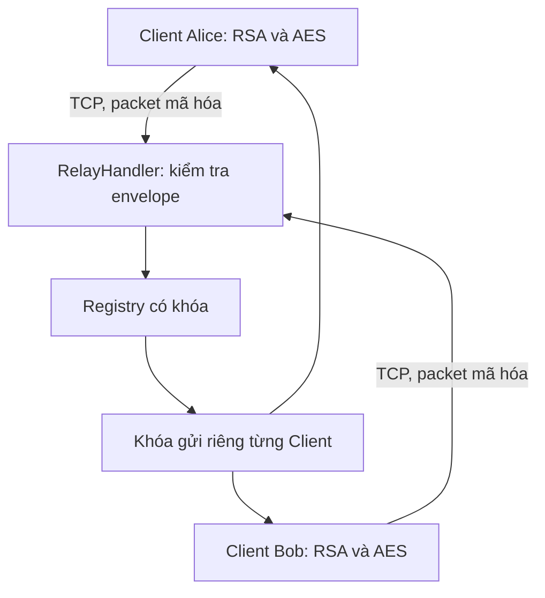
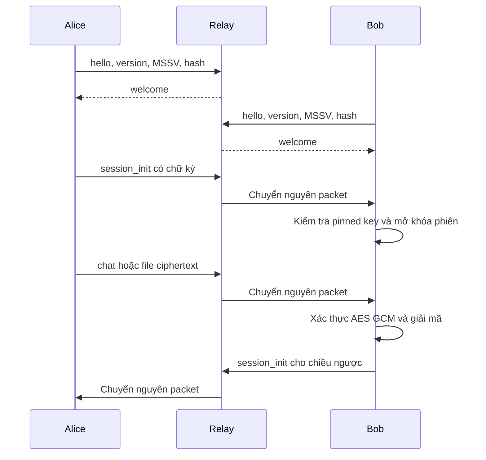

# Bàn giao Người 1: Network, TCP Server và tích hợp

## Phạm vi và mốc mã nguồn

Bản cập nhật được xây dựng từ repository `NhatTiens/BTL1MM-ANM`, nhánh `main`, commit `23066169adc7a6d73f379bc24cb78e6b90fda36f`. Công việc được thực hiện trên nhánh local `feature/owner1-server`. Gói bàn giao là `owner1-server.patch` để người dùng kiểm tra và áp dụng thủ công. Không push, tạo Pull Request hoặc merge lên GitHub trong lần bàn giao này.

Trước khi chỉnh sửa đã đọc README, phân công, giao thức, kiến trúc, bảo mật, kế hoạch kiểm thử, cấu hình dự án, Server, Protocol, Client, Session, Crypto, Transfer và các test liên quan. Môi trường ban đầu thiếu pytest; sau khi cài `python -m pip install -e ".[dev]"`, bộ kiểm thử của commit gốc được chạy trong worktree riêng với `PYTHONPATH` trỏ vào source gốc: **14 passed in 8.22s**. Không xóa, sửa hoặc bỏ qua test gốc.

Phần đã hoạt động được giữ lại gồm TCP length prefix, registry có khóa, so sánh handler khi unregister, kiểm tra người gửi theo kết nối, SessionManager, RSA, AES và truyền file. Các thiếu sót đã xử lý là lỗi kiểu dữ liệu đầu vào, JSON không chuẩn, handshake chấp nhận boolean thay số phiên bản, số thread chưa được giới hạn, thiếu đóng socket khi dừng, khả năng relay tới người dùng trước welcome, lỗi người nhận chưa được dọn registry và thiếu logging đủ dùng. Lệnh shutdown ở cùng thread sau khi serve_forever kết thúc có thể gây treo khi Ctrl+C; luồng CLI mới thoát qua server_close.

## Mục tiêu và kiến trúc

Relay nhận nhiều kết nối TCP và chuyển nguyên object packet từ Client gửi đến Client nhận. Server chỉ xử lý metadata phục vụ đăng ký, quản lý kết nối và định tuyến. Nó không tạo, đọc hay lưu private key, không mở khóa phiên, không giải mã ciphertext. Module Server hiện chỉ dùng standard library và Protocol, không import Crypto.



Mỗi kết nối được phục vụ bởi một handler thread. Registry dùng RLock; mỗi handler có một Lock riêng cho mọi lần ghi socket, bao gồm welcome, peers, error và packet được chuyển tiếp. Registry lock chỉ bảo vệ thao tác bộ nhớ, không giữ trong lúc gửi mạng. Việc đăng ký và phát welcome giữ cùng send lock để một thread khác không đưa packet đến trước welcome.

## Đăng ký và giới hạn danh tính

Packet đầu tiên phải có type hello và version là số nguyên 1, không chấp nhận boolean hay chuỗi "1". Name dài từ 1 đến 24 ký tự, chỉ cho phép chữ ASCII, chữ số, dấu gạch dưới và dấu trừ. Name được dùng như nhãn định tuyến duy nhất trong các kết nối đang hoạt động. Hai thread đăng ký cùng name được phân xử nguyên tử trong register.

MSSV phải là list gồm 2 đến 4 chuỗi không rỗng chứa chữ số ASCII. Handshake phải khớp chính xác `Hello, We are ` nối các MSSV bằng dấu phẩy và khoảng trắng. Hash phải bằng SHA256 của MSSV nối liền theo đúng thứ tự, không có dấu phân cách. Chuỗi có khoảng trắng, phần tử số nguyên hoặc ký tự số Unicode bị từ chối tại ranh giới mạng. Client hiện có đã chuẩn hóa MSSV trước khi tạo hello, nên luồng sử dụng hợp lệ vẫn tương thích.

Server kiểm tra tính nhất quán của các trường mà chính Client cung cấp. Server không có danh sách MSSV thật để đối chiếu, không xác thực quyền sở hữu MSSV và không dùng group_seed_hash để chứng minh danh tính. Việc chiếm một tên chưa được sử dụng vẫn có thể xảy ra. Xác thực đối tác mật mã thuộc về khóa công khai đã pin tại Client.



## Framing và serialization

VERSION vẫn bằng 1, MAX_FRAME_BYTES vẫn bằng 512 × 1024 byte. Bốn byte unsigned big endian đầu tiên biểu diễn độ dài JSON UTF 8, không bao gồm chính prefix. _read_exact lặp đến khi đủ số byte nên không giả định một lần recv tương đương một packet. Nhiều frame ghép trong một TCP stream vẫn được đọc tách riêng. EOF trong header hoặc body được báo bằng EOFError; timeout và lỗi socket được truyền cho tầng xử lý kết nối.

canonical_json giữ nguyên sorted keys, ensure_ascii=False và separators dấu phẩy, dấu hai chấm. Byte đầu ra cho JSON hợp lệ của các module mật mã không đổi. Dữ liệu không biểu diễn được bằng JSON chuẩn bị từ chối: giá trị bytes, khóa không phải chuỗi, số không hữu hạn, Unicode surrogate không hợp lệ, cấu trúc vòng và độ sâu quá 64. Decoder từ chối JSON sai, khóa trùng, NaN, Infinity và số tràn sang vô hạn. Các trường hợp này không thuộc hợp đồng packet hợp lệ trước đây.

pack_packet và recv_packet yêu cầu object có type là chuỗi không rỗng. Kiểu packet chưa được Server hỗ trợ nhận error ở tầng Server. Khung quá ngắn, quá lớn hoặc JSON hỏng kết thúc kết nối sau phản hồi error nếu còn gửi được; không tiếp tục dò ranh giới trên luồng hỏng. Đầu vào mạng được giới hạn kích thước trước khi đọc body. Đầu vào Python tự tạo rất lớn vẫn cần được serialize trước khi đo kích thước và không được coi là nguồn không tin cậy đã được sandbox.

## Định tuyến và tính tương thích

| Packet | Kiểm tra tại Relay | Kiểm tra thuộc Client |
|---|---|---|
| session_init | Sender theo kết nối, recipient hợp lệ, session_id 32 hex, group_seed_hash 64 hex, wrapped_key và signature là chuỗi không rỗng | Base64, chữ ký RSA PSS, pinned key, nhóm, mở khóa RSA OAEP và chống replay |
| chat | Sender, recipient, ciphertext chuỗi không rỗng, seq số nguyên dương; kiểm session_id và nonce khi có envelope đầy đủ | Giải mã AES GCM, tag, AAD, khóa phiên và thứ tự seq |
| file_meta và file_done | Envelope đầy đủ của dữ liệu mã hóa và transfer_id 32 hex | Metadata mã hóa, kích thước, hash, trạng thái truyền file |
| file_chunk | Các kiểm tra trên và index số nguyên không âm | Thứ tự chunk, giới hạn kích thước và toàn vẹn nội dung |
| list_peers | Kết nối đã đăng ký | Hiển thị names |

Relay chặn các trường rõ bị cấm gồm plaintext, message, filename và size ở cấp packet định tuyến. Relay không sửa packet, không tăng seq và không thêm header vào dữ liệu đã ký hoặc AAD. Các trường mở rộng khác vẫn được chuyển nguyên để giữ tương thích; Server không thể chứng minh một chuỗi do Client gửi thật sự đã được mã hóa. Client hợp lệ phải dùng SessionManager và Transfer để tạo dữ liệu gửi.

Test gốc `tests/test_server.py` cố ý gửi chat relay tối giản chỉ có sender, recipient, ciphertext và seq. Để giữ test và hợp đồng relay cũ, Server tiếp tục nhận chat khi cả session_id lẫn nonce đều vắng mặt. Nếu có một trong hai thì cả hai phải hợp lệ. Đây chỉ là khả năng vận chuyển opaque data cho test; ChatClient thật không thể giải mã một chat thiếu thông tin phiên. File packet và session_init không có ngoại lệ này. Đề xuất cho nhóm là chuyển test probe sang envelope đầy đủ và thống nhất siết chat ở phiên bản sau, không âm thầm thay đổi trong patch này.

## Quản lý kết nối và lỗi

register, unregister, list_names và find giữ nguyên giao diện. unregister chỉ xóa name khi registry vẫn trỏ tới đúng handler được truyền vào, tránh thread cũ xóa nhầm phiên mới dùng lại name. Khi gửi đến người nhận thất bại vì BrokenPipeError, ConnectionResetError hoặc TimeoutError, Server unregister đúng handler đích và shutdown socket để giải phóng thread đọc; người gửi nhận error nếu kết nối còn dùng được.

Các lỗi envelope có ranh giới frame rõ ràng như sender giả, recipient sai, thiếu ciphertext hay seq sai được phản hồi error và cho phép Client gửi packet kế tiếp. Lỗi handshake, framing, JSON hoặc ngắt kết nối kết thúc handler. Lỗi bất ngờ chỉ được log tên lớp ngoại lệ; không log exception message có thể chứa dữ liệu do Client cung cấp.

process_request giữ số kết nối đang phục vụ tối đa 64 theo mặc định, tính cả socket chưa gửi hello. Khi hết chỗ, socket mới bị đóng ngay, không tạo thêm thread và không gửi error vì chưa có phiên hợp lệ. Handshake timeout mặc định 10 giây, timeout I/O sau đăng ký 60 giây. reply có giới hạn chờ khóa gửi bằng idle_timeout. Có thể cấu hình ba giá trị qua constructor hoặc CLI. server_close shutdown tất cả socket đang phục vụ trước khi join handler thread, giúp giải phóng đọc và ghi đang chờ.

Timeout socket là timeout cho thao tác I/O, không phải thời hạn tuyệt đối của toàn frame. Một Client gửi từng phần trước mỗi lần hết timeout vẫn có thể chiếm một slot lâu dài. Giới hạn kết nối giảm mức sử dụng tài nguyên nhưng không giải quyết hết slowloris hay DoS. Không triển khai rate limiting theo packet, tránh vô tình chặn chuỗi file chunk hợp lệ. Các giới hạn trên phù hợp demo local; không thay thế cơ chế chống lạm dụng ở môi trường công khai.

## Logging

CLI ghi thời gian, mức log, sự kiện mở kết nối, đăng ký, tên đã kiểm tra, số Client, ngắt kết nối và lớp lỗi. Bật debug để xem loại packet được định tuyến. Không ghi địa chỉ IP, MSSV, hash nhóm, nội dung chat, tên file, ciphertext, wrapped_key, signature, private key hoặc toàn bộ packet. Log vẫn chứa username và thời điểm, nên không phải dữ liệu hoàn toàn ẩn danh.

## Kiểm thử thực tế

Kiểm thử thực hiện ngày 20/10/2026 trên Linux x86_64, Python 3.12.14, cryptography 49.0.0 và pytest 9.1.1. Tất cả kết nối thử dùng 127.0.0.1 với port hệ điều hành cấp hoặc socketpair; không thử nghiệm lên dịch vụ bên thứ ba. Các danh tính và file thử nằm trong tmp_path của pytest, không đưa private key vào patch.

Sau thay đổi, chạy `python -m pytest -q` đạt **108 passed in 11.31s**, không thất bại, không skip trên Linux. Tổng gồm 14 test gốc và 94 trường hợp mới sau khi pytest mở rộng tham số. Các test mới nằm riêng trong `tests/test_owner1_protocol.py` và `tests/test_owner1_server.py`.

| Nhóm bằng chứng | Kết quả quan sát |
|---|---|
| Đăng ký và danh sách | Hai Client thành công; tên trùng, tên sai, MSSV sai, handshake sai và version sai bị từ chối |
| Tranh chấp đăng ký | 8 Client cùng tên chỉ có 1 welcome và 7 error |
| Gửi đồng thời | 8 người gửi, mỗi người 20 packet đến Bob; nhận đủ 160 packet, thứ tự từng người được giữ |
| Race welcome | Client nhận welcome trước packet đang đua với thời điểm đăng ký |
| Định tuyến | session_init, chat, file_meta, file_chunk, file_done được chuyển nguyên object |
| Lỗi socket | EOF, TCP reset, frame cắt, người nhận gửi thất bại và timeout được xử lý; Client khác tiếp tục hoạt động |
| Vòng đời | Đóng Server đánh thức handler, registry và tập kết nối rỗng; CLI thoát mã 0 sau SIGINT khi Client còn kết nối |
| Protocol | Unicode, phân mảnh, nhiều frame liên tiếp, biên đúng 512 KiB, quá giới hạn, JSON hỏng và kiểu dữ liệu sai đều có test |
| Không giải mã tại relay | Monkeypatch các hàm decrypt, unwrap_key, load_private thành hàm báo lỗi; relay vẫn chuyển packet thành công |
| Logging | Marker ciphertext và MSSV không xuất hiện trong log đã thu |

Test `test_actual_chatclients_two_way_chat_files` tạo hai ChatClient thật, gọi connect, command và chạy receive loop thật của chúng. Alice và Bob đều đăng ký, mỗi bên tạo session_init riêng, gửi tin nhắn tiếng Việt có emoji và giải mã đúng ở phía kia. Mỗi chiều truyền ba file 0 byte, 1.024 byte và 70.000 byte có tên Unicode. Tất cả sáu file nhận trùng nội dung và SHA256 với file nguồn; không còn file .part sau khi hoàn tất. Quan sát packet tại relay không thấy marker plaintext, marker nội dung file hay tên file Unicode. Đây là kiểm chứng mẫu dữ liệu trong test, không phải chứng minh mật mã tổng quát.

Test tích hợp không thay mã của Người 2 và Người 3. Monkeypatch trong test chỉ quan sát packet, kết quả giải mã và thread nhận, không thay thuật toán. Sau test, socket Client, thread nhận, handler và Server đều được đóng. Test SIGINT chỉ chạy trên POSIX; trên Windows nó được đánh dấu skip vì mô hình tín hiệu khác, các test vòng đời còn lại vẫn được giữ.

## File và hàm thay đổi

`srcs/securechat/protocol.py` hoàn thiện ProtocolError, canonical_json, pack_packet, _read_exact, recv_packet và send_packet, bổ sung các hàm nội bộ để kiểm JSON, packet, khóa trùng và hằng số không hợp lệ. Chữ ký các hàm public được giữ nguyên.

`srcs/securechat/server.py` bổ sung kiểm envelope và handshake, giới hạn kết nối, process_request, process_request_thread, server_close, disconnect và error; sửa reply, handle, main và kiểm tra register. Constructor nhận thêm tham số keyword tùy chọn, nên lời gọi RelayServer(address) cũ vẫn hoạt động.

Hai file test Owner 1 được thêm mới. `docs/PROTOCOL.md`, `docs/SECURITY.md` và README được cập nhật tối thiểu để chỉ tới tài liệu này và phản ánh giới hạn thực tế. Không sửa client.py, session.py, crypto.py, transfer.py, test gốc hoặc dependency của dự án.

## Áp dụng patch và chạy lại

Đặt owner1-server.patch vào thư mục gốc repository. Kiểm tra `git status --short`; nếu có thay đổi riêng đang làm, commit hoặc cất riêng trước khi áp dụng. Patch được tạo từ commit gốc nêu trên. Nếu nhánh đã thay đổi, dùng git apply --check để phát hiện xung đột và không ép ghi đè.

```bash
git switch -c feature/owner1-server
git apply --check owner1-server.patch
git apply owner1-server.patch
python -m pip install -e ".[dev]"
python -m pytest -q
```

Nếu nhánh đã tồn tại, dùng `git switch feature/owner1-server` thay lệnh tạo nhánh. Sau khi xem thay đổi và chạy test thành công, có thể commit những file được liệt kê trong phần trên. Không chạy git add . nếu thư mục có dữ liệu riêng chưa kiểm tra.

Để demo, từ thư mục gốc chạy `python -m securechat.demo_setup` một lần khi chưa có danh tính demo. Script sẽ từ chối ghi đè key hiện có. Mở ba terminal và chạy các lệnh tương ứng dưới đây. Thay danh sách MSSV bằng MSSV thật của nhóm theo cùng thứ tự ở cả hai Client.

```bash
python -m securechat.server --host 127.0.0.1 --port 9009 --debug
```

```bash
python -m securechat.client --name alice --mssvs 2312345,2312346,2312347,2312348
```

```bash
python -m securechat.client --name bob --mssvs 2312345,2312346,2312347,2312348
```

Tại Alice nhập `/peers`, `/connect bob`, `/msg bob Xin chào Bob` và `/file bob sample_data/hello.txt`. Tại Bob nhập `/connect alice` rồi `/msg alice Bob đã nhận được`. File nhận mặc định ở `.local/received/bob/`. Dùng `/quit` để đóng Client, Ctrl+C để dừng Server. Nếu cần để demo nghỉ lâu, có thể tăng `--idle-timeout 600`; thay đổi này cũng tăng thời gian I/O chờ nên chỉ chọn theo nhu cầu thử nghiệm.

## Giới hạn và hướng phối hợp

Chưa chạy trên Windows hoặc mạng LAN thật, chưa đo throughput và chưa kiểm tra mất mạng diện rộng. Không có TLS, xác thực tài khoản ở relay, hàng đợi offline, ACK, retry hay khôi phục file dang dở. Mặc định Client im lặng hơn 60 giây bị đóng và cần kết nối lại; Client hiện tại chưa có tự động reconnect. Cơ chế giải phóng file .part khi một phiên truyền bị bỏ giữa chừng thuộc Người 3, chưa được sửa trong patch này. Kiểm thử gửi lỗi ở người nhận dùng lỗi socket được chèn có kiểm soát; TCP reset của Client cũng được thử bằng socket local thật.

Server chỉ chuyển ciphertext không có nghĩa là hệ thống tự động chống MitM. Client cần xác minh fingerprint và pin đúng public key qua kênh tin cậy độc lập. MSSV, hash nhóm, username và welcome đều không thay thế xác thực đó. Hệ thống còn lộ metadata giao thông và chưa có forward secrecy, rotation hay quản lý phiên dài hạn hoàn chỉnh. Người 2 phụ trách vòng đời khóa; Người 3 phụ trách ACK, reconnect, dọn truyền dở và UI; Người 4 cần kiểm tra lại trên máy Windows, ghi hình demo và tổng hợp báo cáo.

Trạng thái **Đã hoàn thành và kiểm thử** gồm Server, Protocol, kiểm thử hồi quy, tích hợp hai ChatClient trên localhost, truyền file hai chiều, dọn tài nguyên và tài liệu phần Người 1. Trạng thái **Đã triển khai nhưng chưa xác minh** không có tính năng mã nguồn nào được chủ ý bỏ kiểm thử; khả năng chạy trên Windows, nhiều máy và tải thực tế chưa được kiểm chứng. Trạng thái **Chưa hoàn thành** gồm các hướng phát triển và phần việc ngoài Người 1 vừa nêu; không có Pull Request, push hoặc merge trong lần bàn giao patch này.


## Bổ sung sửa lỗi đóng Server trên Windows

Người dùng chạy bản patch đầu trên Windows và báo 106 passed, 1 failed, 1 skipped. Test thất bại là test_close_wakes_live_handlers vì thread server_close vẫn còn chạy sau 3 giây. Mục skip SIGINT là chủ ý do test đó chỉ hỗ trợ POSIX; thông báo cập nhật pip không phải nguyên nhân lỗi test.

Bản bổ sung owner1-windows-shutdown-fix.patch áp dụng sau owner1-server.patch. Server đặt Event dừng trước khi shutdown socket và join thread. Lớp nội bộ _InterruptibleReader dùng select.select với khoảng chờ tối đa 0,1 giây, kiểm tra Event của Server và handler giữa các lần chờ. recv_packet vẫn dùng cùng cơ chế framing; dữ liệu đã đọc dở không bị bỏ khi một khoảng polling kết thúc. Timeout handshake và idle được đo bằng monotonic theo từng lần recv, vẫn giữ giá trị cấu hình cũ. Không hạ timeout toàn socket xuống 0,1 giây vì socket còn được thread khác dùng để gửi.

Cách sửa loại bỏ việc chỉ dựa vào shutdown từ thread khác để đánh thức vòng đọc đang chờ. select hỗ trợ socket trên Windows theo tài liệu Python. Patch không đổi daemon_threads=False, block_on_close=True, không tăng thời hạn test và không bỏ test lỗi. Việc gửi vẫn dùng timeout socket đã cấu hình; sửa đổi này tập trung vào hủy vòng đọc trong lúc đóng kết nối.

Thêm bốn trường hợp hồi quy mô phỏng shutdown không đánh thức đọc bằng monkeypatch: Client chưa gửi hello, đang gửi dở header, đang gửi dở body và đã đăng ký. Cả bốn thất bại khi chạy với mã trước bản sửa, tái hiện cùng điều kiện closer còn sống. Với mã mới cả bốn đạt. Một test khác gửi hello phân mảnh, nghỉ 0,15 giây giữa các phần để chứng minh polling không làm mất dữ liệu hoặc ngắt Client sớm.

Toàn bộ bộ kiểm thử sau sửa trên Linux đạt 113 passed in 13.07s. Chưa có môi trường Windows trực tiếp để xác nhận bản sửa trên máy người dùng. Kết quả dự kiến ở Windows là 112 passed và 1 skipped cho SIGINT; đây là kỳ vọng cần chạy lại, chưa phải kết quả đã quan sát.

Đặt patch bổ sung vào thư mục gốc đang có bản cập nhật đầu, chạy git apply --check owner1-windows-shutdown-fix.patch, sau đó git apply owner1-windows-shutdown-fix.patch và python -m pytest -q. Không áp dụng lại owner1-server.patch.

Tham khảo kỹ thuật: Python Software Foundation. (n.d.). select — Waiting for I/O completion. https://docs.python.org/3/library/select.html. Python Software Foundation. (n.d.). socketserver — A framework for network servers. https://docs.python.org/3/library/socketserver.html.
